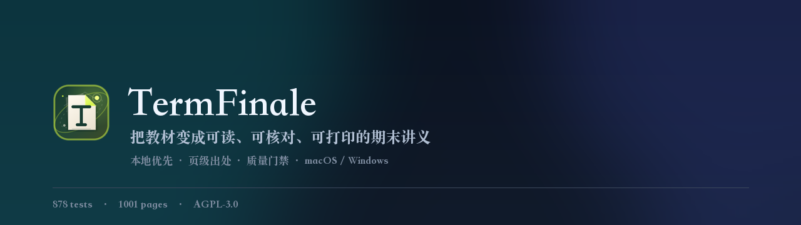
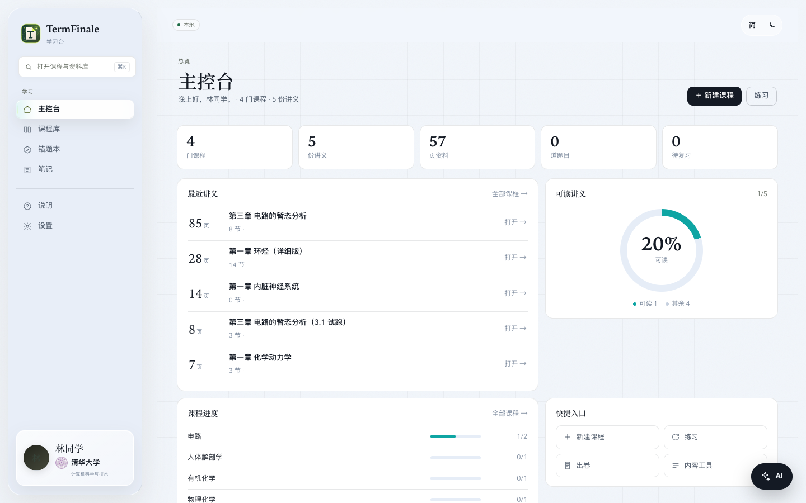
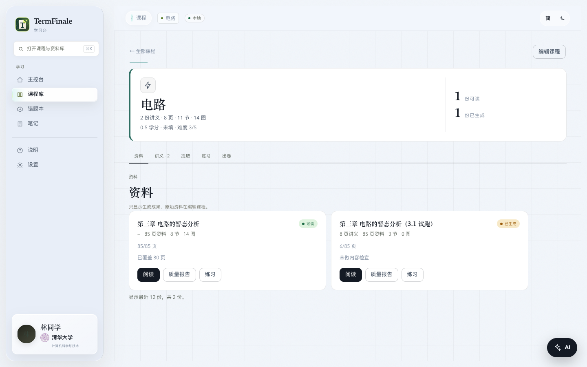
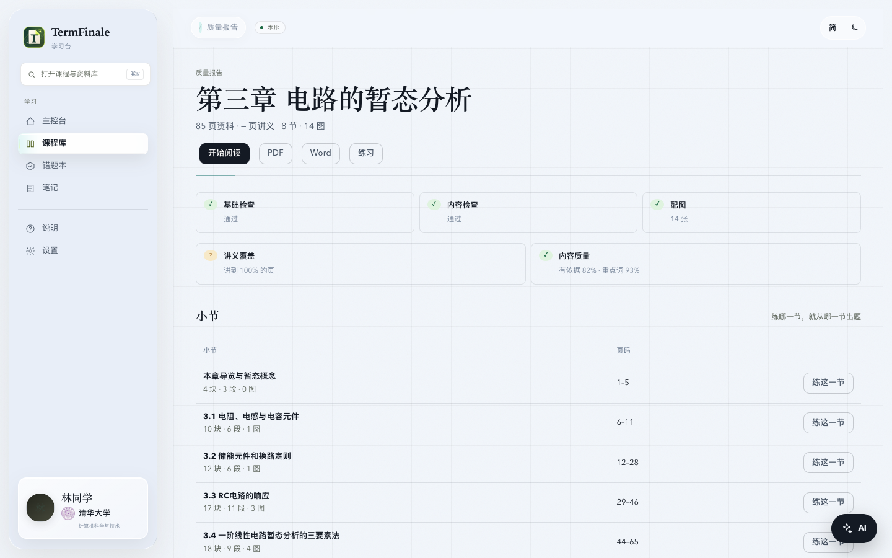
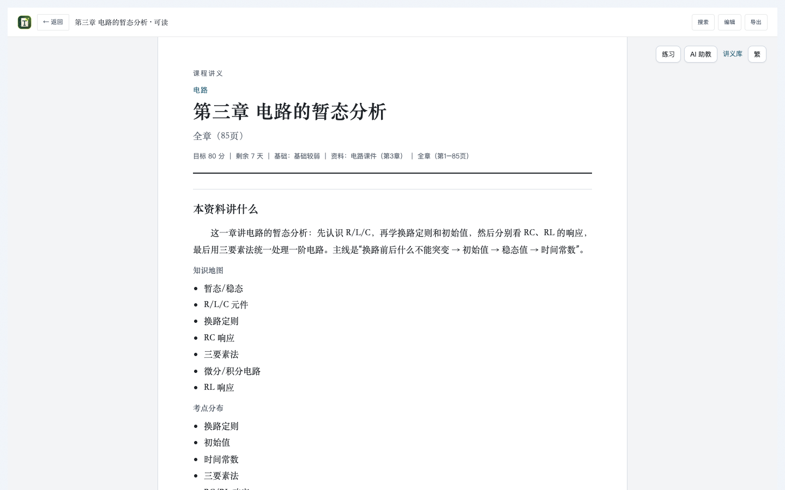
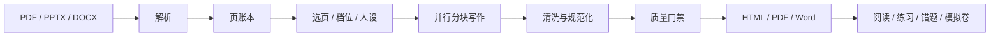

<p align="center">
  
</p>

<p align="center">
  <a href="LICENSE"></a>
  
  
  
</p>

<p align="center">
  <a href="https://shuai-lin2006.github.io/TermFinale/">下载页</a> ·
  <a href="#快速开始">快速开始</a> ·
  <a href="#常见问题">常见问题</a> ·
  <a href="docs/使用说明书.md">使用说明</a> ·
  <a href="docs/发布计划.md">发布计划</a>
</p>

---

TermFinale 是一个**本地优先**的桌面应用：导入 PDF / PPT / Word / 图片，按页选段，生成带原书页码的讲义、练习题和模拟卷，并支持错题复习与 AI 问答。资料、笔记和生成结果都保存在本机。

它不追求“吃透每一个知识点”，而是服务于期末周：**用更少的时间，把一门课复习到能拿分的程度。**

> English summary: TermFinale is a local-first desktop study workspace for Chinese university finals. It turns course materials into page-cited lecture notes, practice questions, and mock exams, with local storage and user-supplied model API keys.

---

## 界面预览

| 主控台 | 课程与讲义 |
|---|---|
|  |  |

| 质量报告 | 阅读器 |
|---|---|
|  |  |

---

## 更新记录

见 [CHANGELOG.md](CHANGELOG.md) 或 [Releases](https://github.com/Shuai-Lin2006/TermFinale/releases)。

## 工程亮点

- **页级溯源**：讲义正文对应原书页码，审计会检查覆盖与出处
- **质量门禁**：结构、内容、PDF、语言、覆盖任一不通过，任务不标“完成”
- **并行分块**：4–8 页一块、最多 4 路并发，13 页约 3 分钟
- **无 LibreOffice 也能读 PPTX/DOCX**：Windows 安装版开箱可用
- **图片型资料**：Qwen-VL 逐页 OCR，再接正常写作管线
- **本地优先**：SQLite、资料、笔记都在本机；模型用用户自己的 Key

## 功能

**资料与讲义**

- 支持 PDF / PPT / PPTX / DOC / DOCX / 图片
- 按页选段，先看 2 页预览，再生成完整讲义
- 每段标注原书页码，可对照核对
- 公式/扫描页保留原页影像，不强行转文字
- 导出 PDF / Word

**质量与审计**

- 质量门禁：结构、内容、PDF、语言
- 逐页覆盖检查：哪一页没讲到，列出来
- 审计驱动的补讲：自动补讲缺口并重渲染
- 引用依据、重点词覆盖、重复与套话检查

**练习与复习**

- 从讲义或资料页出题：选择 / 计算 / 简答
- 判分、解析、页码出处
- 错题本 + 记忆曲线复习计划
- 模拟卷生成（答案审计冲突时整卷退回，不带着错误交付）

**效率工具**

- AI 助教：基于当前讲义的问答，回答带页码引用
- 笔记、全文搜索、本机备份

---

## 下载与安装

**当前状态：Beta。** macOS（Apple Silicon）与 Windows 安装包均已发布。所有版本都在 [Releases](https://github.com/Shuai-Lin2006/TermFinale/releases)。

| 平台 | 要求 | 状态 |
|---|---|---|
| macOS | Apple Silicon（arm64），macOS 11+ | [v0.4.0 已发布](https://github.com/Shuai-Lin2006/TermFinale/releases/tag/v0.4.0) |
| Windows | Windows 10/11 x64 | [v0.4.0 安装包](https://github.com/Shuai-Lin2006/TermFinale/releases/tag/v0.4.0) |

也可以从源码运行，见下方[从源码运行](#从源码运行)。

### 安装提示

- **macOS**：Beta 包暂未签名/公证，首次打开需右键 →「打开」；或在「系统设置 → 隐私与安全性」中允许
- **Windows**：未做代码签名，SmartScreen 提示时选「更多信息 → 仍要运行」

---

## 快速开始

### 1. 准备 API Key

TermFinale 不内置模型额度，需要你自己的 API Key：

| Key | 必填 | 用途 |
|---|---|---|
| DeepSeek | 是 | 讲义生成、出题、对话 |
| 阿里云百炼 | 否 | 内容复核、图片理解 |
| Kimi / Moonshot | 否 | 复核备用 |

Key 只写入本机用户目录的 `.env`，不会上传；随时可以删除或更换。

### 2. 新建课程并导入资料

1. 打开软件，完成三步引导（名字、学校、专业）
2. 进入「设置 → 模型」，填入 DeepSeek Key，点「测试连接」
3. 课程库 →「新建课程」→ 填考试信息 → 上传资料 → 保存
4. 选择页码范围 → 选讲义档位 → 预览 2 页 →「同意继续」生成
5. 生成完成后进入质量页，可补充检查、阅读、练习、出卷

详细步骤见 [使用说明书](docs/使用说明书.md)，软件内「说明」页也有同样内容。

---

## 从源码运行

### 环境

- Python 3.12+（开发使用 3.14）
- macOS 或 Windows
- 可选：本地 MinerU 环境（扫描件 OCR），不装也能处理文字版 PDF

### Windows 一键打包（推荐）

1. 安装 [Python 3.12](https://www.python.org/downloads/release/python-31210/)（安装时勾选 **Add python.exe to PATH**）
2. 在 GitHub 页面点 **Code → Download ZIP**，解压
3. 双击解压目录里的 **`build_windows.bat`**
4. 等 3–10 分钟，生成 `TermFinale-<版本>-win-x64.zip`

不需要安装 Git，也不需要敲命令。

### 从源码运行

```bash
git clone https://github.com/Shuai-Lin2006/TermFinale.git
cd TermFinale
python -m venv .venv
source .venv/bin/activate        # Windows: .venv\Scripts\activate
pip install -r requirements.txt
```

### 启动

```bash
# 仅启动本地服务（浏览器访问 http://127.0.0.1:8907）
.venv/bin/python -m uvicorn tfv2.api.product_app:app --host 127.0.0.1 --port 8907

# 桌面窗口（推荐）
.venv/bin/python desktop.py
```

首次启动后，在「设置 → 模型」填入 API Key。

---

## 工作原理

```text
资料 PDF/PPT/图片
        │
        ▼
页账本（逐页文字 / 图片 / 公式）
        │
        ▼
大纲规划 ──► 分节撰写 ──► 规范化与公式清洗
        │
        ▼
质量门禁（结构 / 内容 / PDF / 语言 / 逐页覆盖）
        │
        ├─ 未通过 ──► 指出问题，不回退成“看起来完成”
        │
        ▼
排版渲染（HTML / PDF / Word）
        │
        ▼
练习、错题、复习、模拟卷
```

核心原则：**可追溯优先于“写得漂亮”**。每段正文都要能对上原书页码，不达标就标出来。

---

## 架构



更完整的模块说明和设计取舍见 [docs/ARCHITECTURE.md](docs/ARCHITECTURE.md)。

## 技术栈

| 层 | 技术 |
|---|---|
| 运行时 | Python 3.14、SQLite |
| 后端 | FastAPI、Uvicorn、Pydantic、SQLAlchemy |
| 前端 | 原生 JavaScript、原生 CSS、KaTeX |
| PDF / 文档 | PyMuPDF、MinerU、pix2tex、Typst、Playwright、python-docx、python-pptx |
| 模型服务 | DeepSeek、阿里云百炼 / Qwen、Kimi / Moonshot（用户自带 Key） |
| 桌面 | pywebview、CustomTkinter、PyInstaller |
| 测试 | unittest（878 项）、自建评测集与基准脚本 |

---

## 项目结构

```text
tfv2/                 产品核心：生成、质量、审计、题库、存储
  api/                本地 HTTP API
  authoring/          分节撰写与规范化
  build.py            讲义渲染与门禁
  ingest/             PDF/PPT 解析、OCR、公式
  quality/            质量门禁、覆盖审计、可信度
  product/            课程、任务、练习、复习、服务
web_v2/               前端（原生 JS/CSS）
core/                 共享基础：配置、日志、模型客户端
tests/                单元测试
docs/                 文档、截图、发布说明
scripts/              评测、基准、工具脚本
desktop.py            桌面入口
TermFinale.spec       PyInstaller 打包配置
```

---

## 测试与质量

```bash
# 单元测试
.venv/bin/python -m unittest discover -s tests -t .

# 评测集（不跑 OCR，快速）
.venv/bin/python scripts/eval_harness.py --no-ocr

# 完整验证（测试 + 评测 + API 文档）
bash scripts/verify.sh
```

当前：**878 项单元测试通过**；评测集讲义不通过 0 / 10；页面与 API 冒烟通过。

质量策略：

- 模型输出必须带出处，缺出处会被丢弃
- 覆盖不足会标「部分提取」，不冒充全量
- 答案审计冲突时整卷判「需重做」
- 公式页保留原页影像，不把识别错误当正确答案

---

## 已知限制

- 生成内容仍可能出错，请以原书为准
- 公式/图片页不能直接出文字题，需要选文字页
- 扫描件 OCR 较慢；可选「快速保存」，把识别推迟到首次生成
- 质量检查是程序 + 模型，不是人工逐页复核
- 需要联网和 API Key；资料、笔记保存在本机
- 不是系统学习工具，不适合想逐字吃透教材的场景

---

## Roadmap

- 更完整的本地模型支持，减少联网依赖
- 公式可搜索、可出题、可校对
- 按错题和掌握度安排每日复习页
- 多设备迁移与端到端加密备份
- 讲义模板、导出样式
- Anki / Markdown 互通
- 更清楚的“哪里可能有问题、为什么”质量报告

---

## 参与与反馈

- 提交 Issue：bug、内容错误、功能建议
- 愿意提供课程资料试用、或参与开发，欢迎联系
- 联系方式见软件内「说明 → 产品介绍」

反馈问题时请附：版本与系统、资料类型（文字版/扫描件/PPT）、问题截图或页码。

---

## License

本项目以 **GNU Affero General Public License v3.0（AGPL-3.0）** 发布，见 [LICENSE](LICENSE)。

选择 AGPL 的原因：项目使用 [PyMuPDF](https://github.com/pymupdf/PyMuPDF) 和 [MinerU](https://github.com/opendatalab/MinerU)（均为 AGPL-3.0）处理 PDF 与扫描件。按 AGPL 分发时需提供对应源码；本仓库即为源码，下载页也会给出源码入口。

第三方组件与许可证清单见 [THIRD_PARTY_NOTICES.md](THIRD_PARTY_NOTICES.md)。

---

## 免责声明

本项目为个人开发的学习工具，与任何学校、考试机构无关。生成内容由模型产生，可能存在错误；请以课程资料和教师要求为准，不要将生成内容直接作为考试依据。
