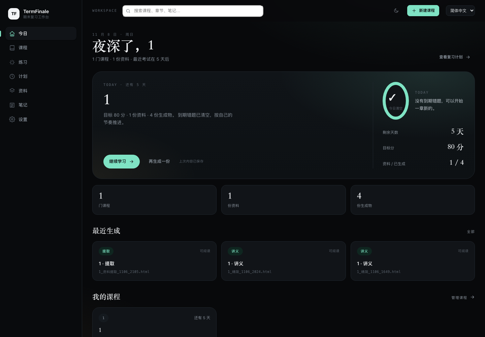
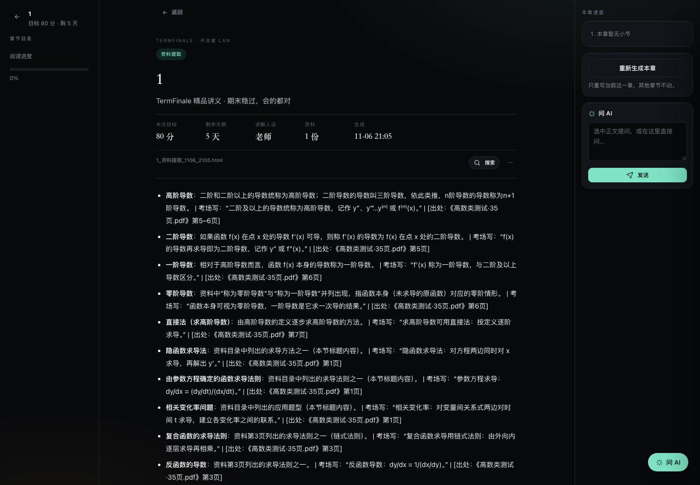
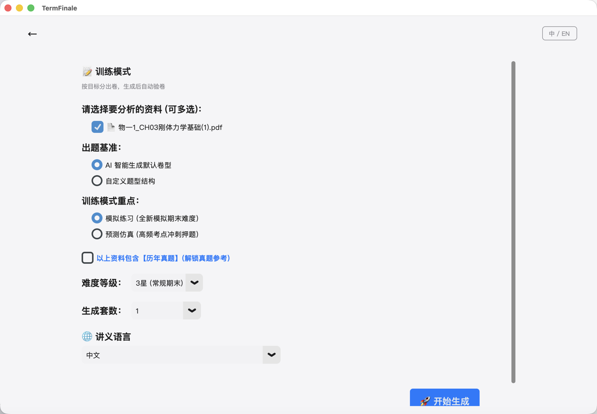
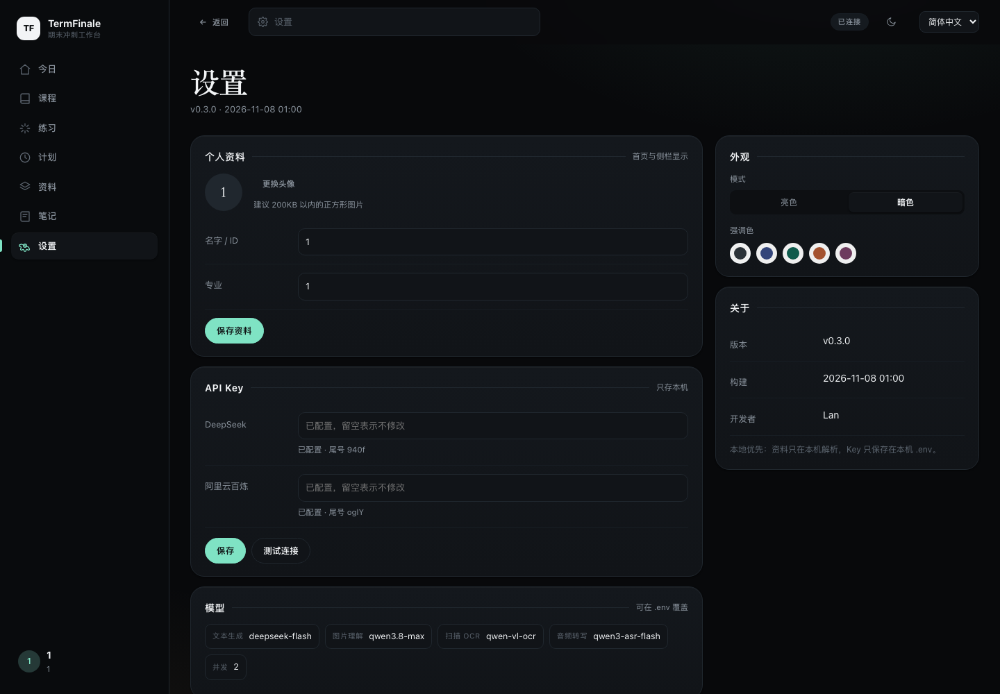

# TermFinale

> 把一堆课件，压成一份能在剩余天数内读完的期末讲义。


TermFinale 是一个面向大学生的**桌面端期末复习工具**：导入 PPT / PDF / Word，本地解析文本与图形，结合你的考试信息规划大纲，逐章生成讲义、逻辑图、考点清单和模拟试卷，最后输出成可以直接打印的单文件 HTML。

不是聊天框，而是一条“上传资料 → 生成复习材料”的流水线。

---

## 目录

- [界面预览](#界面预览)
- [能做什么](#能做什么)
- [下载与安装](#下载与安装)
- [第一次使用](#第一次使用)
- [怎么用效果最好](#怎么用效果最好)
- [常见问题](#常见问题)
- [隐私与免责](#隐私与免责)
- [技术栈与项目结构](#技术栈与项目结构)
- [本地开发](#本地开发)
- [打包](#打包)
- [Roadmap](#roadmap)
- [License](#license)

---

## 界面预览









## 能做什么

| 模块 | 产出 |
|---|---|
| **讲义** | 先出大纲再逐章生成，每章包含：必背要点、公式卡、例题、原位配图、自测。支持「全量 / 精简」、5 种讲解人设、中英双语 |
| **逻辑分析** | 一次生成：知识图谱（Mermaid）+ 因果链 + 概念/公式/题型对照表 |
| **资料提取** | 按页打包提取名词、考点、原题；自动去重并报告覆盖了哪些页 |
| **练习卷** | 提取原题并生成「无答案 + 每题留白」的打印版，题号由程序统一重排 |
| **训练试卷** | 按目标分生成「题型 × 数量 × 分值」蓝图，生成后自动验卷（缺题、分值、重复题、考点标注） |
| **配图** | 把 PPT/PDF 里的图形区域渲染成图片，按原位置插回讲义；矢量图也能取 |
| **扫描件 OCR** | 没有文字层的扫描版 PDF 会自动用视觉模型转录成文字（结果有缓存） |
| **复习管理** | 课程紧迫度模型、剩余天数、今日建议、自定义笔记与资料归档 |

生成物是**单文件 HTML**：自带公式渲染、思维导图、名词弹窗、搜索、打印/导出 PDF。

## 下载与安装

> 当前为 **内测版本**，仅提供 macOS (Apple Silicon) 安装包；Windows 版本需自行构建（见 [打包](#打包)）。

前往 [Releases](../../releases) 下载最新的 `TermFinale.app.zip`，解压后把 `TermFinale.app` 拖进「应用程序」。

### macOS：提示“无法验证开发者”

因为安装包没有做 Apple 公证，首次打开会被 Gatekeeper 拦截。任选一种方式：

- **方式一**：在「应用程序」里**右键**点击 `TermFinale.app` → 打开 → 再点「打开」
- **方式二**：终端执行一次

```bash
xattr -dr com.apple.quarantine /Applications/TermFinale.app
```

### Windows

解压后直接运行 `TermFinale.exe`。若出现 SmartScreen 提示，点「更多信息」→「仍要运行」。

> Windows 版本需要在 Windows 机器上构建，步骤见 [`docs/BUILD_WINDOWS.md`](docs/BUILD_WINDOWS.md)。

## 第一次使用

### 1. 配置 API Key（必做）

TermFinale **不内置 Key**，需要你自己的大模型账号。打开软件 → 右上角 **⚙ 设置**：

| 字段 | 是否必填 | 用途 | 去哪申请 |
|---|---|---|---|
| DeepSeek API Key | ✅ 必填 | 文本生成（讲义/提取/试卷） | <https://platform.deepseek.com> |
| 阿里云百炼 API Key | 选填 | 给图片生成文字说明 | <https://bailian.console.aliyun.com> |

粘贴后点「测试连接」，看到 `DeepSeek ✅` 再保存。

- Key 只保存在你本机的用户数据目录，**不会上传**。
- 不填百炼 Key 也能用，只是图片下方显示「第 N 页配图」。
- 费用按调用量计费，一份 32 页讲义大约几毛钱，个人使用通常每月几元到十几元。

### 2. 新建科目

填写课程名、学校层级、学分、是否专业课、剩余天数、目标分数。这些信息会影响 AI 的讲法：

- 只剩 3 天 → 自动偏向“只保必考”的精简讲法
- 目标 90+ → 增加推导与综合题
- 专业课 / 学分高 → 内容更硬核

### 3. 上传资料并生成

建议把资料分成「核心重点」（老师划的重点、真题）和「参考资料」（教材、课件）。上传后选择：

- **全量讲义**：时间充裕，想学透原理
- **精简讲义**：时间紧张，只讲核心拿分套路
- **AI 导师人设**：老师 / 学术AI / 暴力极客 / 温柔小姐姐 / 阳光小哥哥

生成完成后会自动打开预览页，可点「在浏览器中打开」或「导出 PDF」。

## 怎么用效果最好

1. **优先上传 PDF**：PPT 转换后的 PDF 通常排版更稳定；PPT 也能用，但图片和公式的还原度略低。
2. **首次生成会慢**：需要逐个识别图片（32 页约 3 分钟），**第二次生成同一份资料几乎秒过**（图片说明与大纲都有缓存）。
3. **资料越“脏”越要分类**：把真题/重点放“核心”，教材放“参考”，权重滑块才有意义。
4. **人设只影响语气**，不影响知识点；想要最密的信息量选「学术AI」。
5. **生成内容请对照原始资料**：AI 会标注出处页码，也会用 `【延伸】` 标出资料之外的补充，两者要区分看。

## 常见问题

**Q：双击没反应 / 打不开？**
见上文 Gatekeeper 处理方式；仍不行请查看日志：`~/Library/Application Support/TermFinale/logs/`。

**Q：提示“还没有配置 API Key”？**
右上角 ⚙ 设置里填入 DeepSeek Key。

**Q：点了生成一直转圈？**
首次生成需要解析文件并识别图片，比较慢；界面会显示「已用时间 / 预计剩余」。第二次会很快。

**Q：图片下面只写“第 N 页配图”？**
没有配置阿里云百炼 Key，或该图被判定为装饰图。配好 Key 后重新生成即可。

**Q：报错“生成结果为空” / “余额不足”？**
通常是 API Key 无效、欠费或触发了限流。到对应平台检查余额后重试。

**Q：生成的内容有错误怎么办？**
AI 生成内容仅供参考，请以原始资料为准。发现明显错误欢迎提 Issue，附上课程与资料类型即可。

**Q：我的数据存在哪？怎么备份/删除？**

| 系统 | 目录 |
|---|---|
| macOS | `~/Library/Application Support/TermFinale/` |
| Windows | `%APPDATA%\TermFinale\` |

里面有数据库、解析出的图片、日志、`.env`。整个文件夹拷走即备份，删除即清空。

## 隐私与免责

- 课件**只在本机解析**，不会上传到任何我们的服务器。
- 生成时：文本发送给 **DeepSeek**，图片发送给 **阿里云百炼**（仅用于生成图注），遵循各自的服务条款。
- API Key 仅保存在本机 `.env`，不写入代码、不随程序分发。
- AI 生成内容可能存在错误或遗漏，**请以原始资料为准**，不要直接用于正式考试以外的用途。
- 请勿上传包含个人隐私或涉密内容的资料。

## 技术栈与项目结构

Python + CustomTkinter 桌面应用，本地 SQLite，输出标准 HTML。

```
main.py              UI（CustomTkinter）
launcher.py          打包入口（崩溃日志兜底）
app/desktop/         主题 token + 组件库
services/            用例层：guide / review（不依赖 UI）
core/
  paths.py           跨平台数据目录
  config.py          密钥与 .env
  parser.py          文档解析
  parsing/figures.py 图形区域检测与渲染
  generate/          大纲、组卷蓝图
  quality/qa.py      生成质量校验
  exporter.py        Markdown → 单文件 HTML
models/              课程紧迫度模型
tests/               单元测试
tools/               冒烟与打包脚本
```

## 本地开发

```bash
python -m venv .venv && source .venv/bin/activate   # Windows: .venv\Scripts\activate
pip install -r requirements.txt

cp .env.example .env      # 填入你的 Key
python main.py
```

改完代码跑一遍离线冒烟（不联网、不花钱）：

```bash
python tools/smoke.py
```

单独跑测试：

```bash
python -m tests.test_weights
python -m tests.test_maintenance
python -m tests.test_config
```

## 打包

```bash
pip install pyinstaller
python tools/build.py
```

- macOS 产物：`dist/TermFinale.app`
- Windows 产物：`dist/TermFinale/TermFinale.exe`
- **建议 Python 3.12**：PyInstaller 对新版本解释器支持滞后
- 详细 Windows 步骤见 [`docs/BUILD_WINDOWS.md`](docs/BUILD_WINDOWS.md)

## Roadmap

- [x] 讲义 / 逻辑分析 / 资料提取 / 训练试卷
- [x] 图形提取与原位配图
- [x] 大纲先行、质量校验、并发生成与缓存
- [x] 应用内 API Key 设置
- [ ] Windows 官方构建与自动发布（GitHub Actions）
- [ ] 考前 1 页速览
- [ ] 错题本 / 自测记录
- [ ] 深色模式、图标体系

## License

[MIT](LICENSE)

## 致谢

- [DeepSeek](https://www.deepseek.com/) 提供文本生成
- [阿里云百炼](https://bailian.console.aliyun.com/) 提供视觉理解
- [CustomTkinter](https://github.com/TomSchimansky/CustomTkinter) / [PyMuPDF](https://pymupdf.readthedocs.io/) / [KaTeX](https://katex.org/) / [Mermaid](https://mermaid.js.org/)
