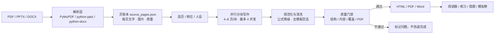

# TermFinale 架构与设计取舍

## 总览

## 模块

| 层 | 位置 | 职责 |
|---|---|---|
| 入口 | `desktop.py` / `launcher.py` | 原生窗口、单实例、更新检查 |
| API | `tfv2/api/product_app.py` | 本地 HTTP、任务、课程、讲义、出卷 |
| 解析 | `tfv2/ingest/` | PDF/PPTX/DOCX、OCR、页账本 |
| 写作 | `tfv2/authoring/` | 分节提示词、事实约束、规范化 |
| 质量 | `tfv2/quality/` | 结构/内容/覆盖门禁、去空话 |
| 渲染 | `tfv2/render/` | HTML、PDF、Word、公式 |
| 前端 | `web_v2/` | 原生 JS/CSS 学习台 |
| 数据 | SQLite + 本地文件 | 课程、任务、讲义、笔记 |

## 关键设计取舍

1. **页账本优先，而不是直接喂整份 PDF**
   模型每次只拿到选中的几页，输出必须带页码；缺页会被审计标出来。这样能核对、能定位，代价是解析和编排更重。

2. **宁可保留原页影像，也不编造公式**
   公式/扫描页识别不稳时，保留原页影像并明确标注；不把 OCR 猜测当结论。

3. **质量门禁会拒绝交付**
   结构、内容、覆盖、PDF 渲染任一不通过，任务不会标“完成”。这会让成功率下降，但避免“看起来完成了”。

4. **长文档并行分块，而不是一次生成**
   4–8 页一块、最多 4 路并发；失败只重试单块。速度从 10+ 分钟降到约 3 分钟，代价是跨块一致性需要规范化兜底。

5. **本地优先 + 用户自带 Key**
   资料、笔记、SQLite 都在本机；模型调用走用户自己的 Key。没有中间服务器，隐私边界清楚，也意味着无法做云端统一限流。

6. **AGPL-3.0**
   依赖 PyMuPDF / MinerU（AGPL），所以整体以 AGPL 发布；下载页给出源码入口。

7. **无 LibreOffice 也能读 PPTX/DOCX**
   Windows 用户通常没装 LibreOffice；用 python-pptx / python-docx 生成中间 PDF，保证文本和页码可用，版式不追求 100% 还原。

## 测试

- 878 项 unittest；CI 在 Ubuntu / macOS / Windows 三平台跑
- 评测集：多份真实教材的页级覆盖、耗时、质量门禁
- 端到端：Mac 与 Windows 虚拟机安装包实测
